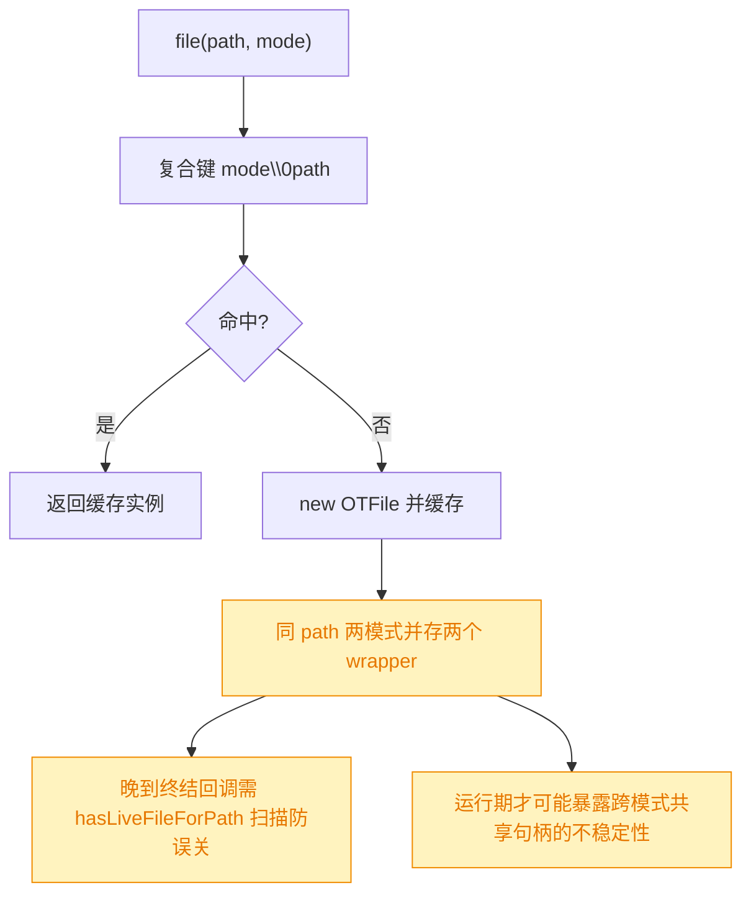
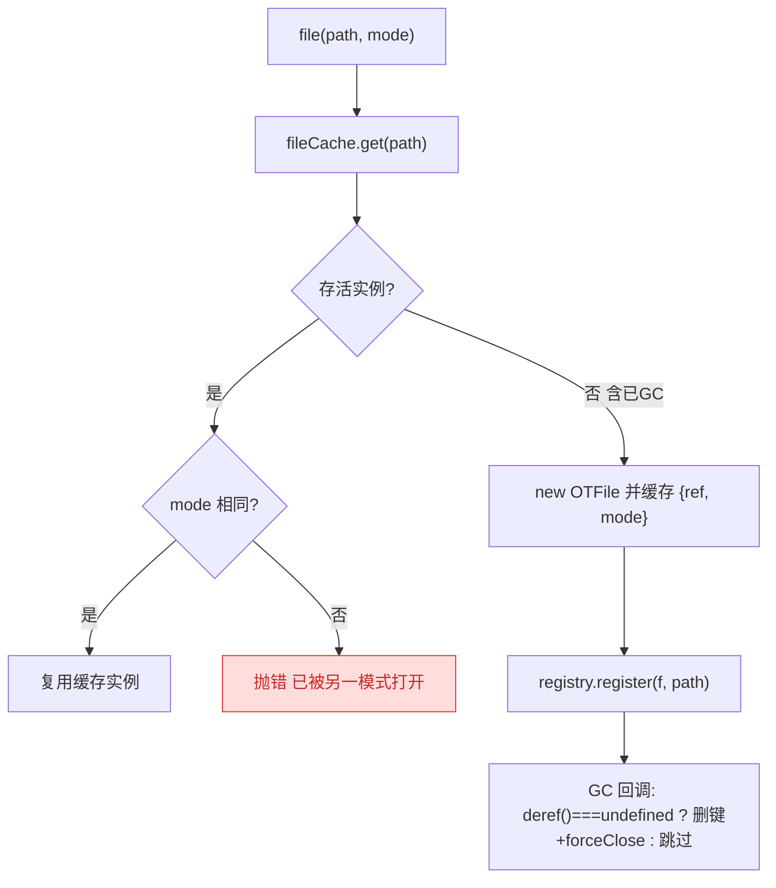
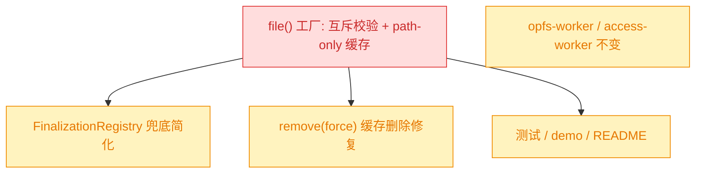

# 同一文件打开模式互斥（创建点前置报错）

## 1. 背景

前序 spec `261020.refct.multi-tab-rw-unsafe` 给 `file()` 引入了打开模式 `TFileMode = 'rw' | 'rw-unsafe'`，并把 `fileCache` 改为 `path + mode` 复合键，使同一 path 的两种模式可以各自缓存成**两个并存的 `OTFile` 实例**。为避免「晚到的终结回调误关另一模式实例正在使用的共享句柄」，其 `FinalizationRegistry` 兜底被迫引入 `hasLiveFileForPath` 跨键扫描，回收逻辑因此变复杂。

用户指出：同一个文件的两种模式本就应当**互斥**。与其让两种模式静默并存、把不稳定性（跨模式共享同一 Worker 句柄、晚到回调误关）藏到运行期，不如在**创建 `OTFile` 时**就检查——若该 path 已存在另一个**已打开模式**的存活实例，直接抛错。把不稳定错误提前暴露在 `file()` 调用点，同时让 `src/file.ts:L12-L37` 的回收兜底逻辑得以简化。

本次为 fix：收紧 `file()` 的创建语义并简化回收逻辑，不改动 `rw` / `rw-unsafe` 各自的底层打开行为。

## 2. 需求

- `file(path, { mode })` 创建时，若 `fileCache` 中已有**同 path、不同 mode** 的存活 `OTFile` 实例，立即抛出描述性错误（指明已存在模式与本次请求模式）。
- 同 path、同 mode 继续复用既有实例（保持现有缓存命中与实例级 writer 互斥语义）。
- 该 path 上原实例已被 GC（`WeakRef` deref 为空）后，允许以任意模式重新创建——互斥只约束**存活**实例。
- 基于「单 path 至多一个存活模式实例」这一新不变量，简化 `src/file.ts` 的缓存与 `FinalizationRegistry` 兜底：去除 `path + mode` 复合键与 `hasLiveFileForPath` 跨键扫描。
- 保持 `rw` / `rw-unsafe` 底层打开行为不变；跨标签页仍依赖浏览器原生锁，不在本次新增跨标签页协调。
- 更新受影响测试、demo 与文档：覆盖「同 path 异模式创建即抛错」「GC 后可换模式重开」，并在文档说明两模式对同一文件不可并存。

## 3. 现状分析

当前 `file()` 以 `mode\0path` 复合键缓存，两模式并存为两个 wrapper；冲突从不在创建点暴露，只可能在更晚的 Worker 打开或 GC 回收时以不稳定方式显现。回收兜底需 `hasLiveFileForPath` 遍历整表，确认同 path 再无其它存活实例才 `forceClose`，以免误关另一模式实例的共享句柄。此外 `remove({ force: true })` 里 `fileCache.delete(this.#path)` 用的是**裸 path**，与复合键不匹配，实为**失效的空删除**（潜在 bug）。

现状精确信息（文件、行号与缺口）

- `src/file.ts:6` `fileCache = Map<string, WeakRef<OTFile>>`；`:8-10` `getFileCacheKey` 以 `` `${mode}\0${filePath}` `` 组键。
- `src/file.ts:12-17` `hasLiveFileForPath`：遍历全表按 `deref()?.path === filePath` 判定是否仍有存活实例。
- `src/file.ts:23-37` `FinalizationRegistry`：held value 为 `{ filePath, cacheKey }`；回调先按 `cacheKey` 清缓存，再 `hasLiveFileForPath` 为假时 `forceClose`。
- `src/file.ts:55-67` `file()`：按复合键命中即返回，否则 `new OTFile(filePath, mode)` 并注册 finalizer。
- `src/file.ts:135-144` `OTFile` 持有 `#mode`（私有、无对外 getter）；`:159,204` reader/writer 透传 `#mode` 给 `createOPFSAccess`。
- `src/file.ts:274-286` `remove()`：force 分支 `fileCache.delete(this.#path)` 与复合键不匹配，删除无效。
- `src/opfs-worker.ts:48-66` `open`：entry 记录 `mode` 并用于 `accessModeMap[mode]` 创建句柄，但**无同 path 异模式冲突校验**（entry.mode 从不比较）。
- `src/__tests__/file.test.ts:50-55` `beforeEach`/`afterEach` 用默认 rw 的 `file(filePath).remove({ force: true })` 清理共享 `filePath`。
- `src/__tests__/file.test.ts:137-145` 断言两模式返回不同 wrapper；`:168-177` 断言异模式在 Worker 打开时抛 `file is already opened in mode "rw"`（该消息在 `opfs-worker.ts` 中实际并不存在，依赖已与现码脱节）。

## 4. 技术实现方案

把「同 path 两模式不可并存」确立为不变量，并在 `file()` 创建点强制：缓存回退为 **path-only 键**，缓存项携带其 `mode`；命中且 mode 相同则复用，mode 不同则抛错；无命中（含原实例已 GC）则新建。由此 `FinalizationRegistry` 兜底可简化为单一 `deref()` 判空，不再需要复合键与跨键扫描。底层 reader/writer/Worker 打开行为一律不动。

### 4.1 创建点互斥与 path-only 缓存

- `fileCache` 改为 `Map<string, { ref: WeakRef<OTFile>; mode: TFileMode }>`，键为裸 `filePath`。把 `mode` 存进**缓存项**而非从实例读取，既能在 `file()` 内比较模式，又无需给 `OTFile` 新增对外 `mode` getter（延续前序「不扩大 API 面」的决策）。
- `file(path, { mode })`：`const hit = fileCache.get(path)`；`const live = hit?.ref.deref()`。
  - `live && hit.mode === mode` → 返回 `live`（命中复用）。
  - `live && hit.mode !== mode` → `throw Error(...)`，消息含 path、已存在 mode、请求 mode。
  - 否则（无项或已 GC）→ `new OTFile(path, mode)`，写入 `{ ref: new WeakRef(f), mode }` 并注册 finalizer。
- 删除 `getFileCacheKey`、`hasLiveFileForPath`。
- `remove({ force: true })` 的 `fileCache.delete(this.#path)` 在 path-only 键下**恢复为有效删除**（顺带修掉现状的空删除 bug）。

### 4.2 简化 FinalizationRegistry 兜底

- held value 由 `{ filePath, cacheKey }` 简化为 `filePath`。
- 回调仅一处判定：`if (fileCache.get(filePath)?.deref?. ... )`——即当 `fileCache.get(filePath)?.ref.deref() === undefined` 时，说明该 path 已无存活实例，**同一处**既 `fileCache.delete(filePath)` 又 `postToOPFS(filePath, 'forceClose')`；否则（晚到回调遇到同 path 新实例）整体跳过，天然不误关新实例。
- 该不变量成立的依据：同 path 任意时刻至多一个存活 `OTFile`（互斥保证不同模式不并存；同模式 `file()` 返回同一缓存实例）。因此无需再跨键扫描其它模式实例。

### 4.3 Worker 与底层打开行为

- `src/opfs-worker.ts` / `src/access-worker.ts` **不改**：mode 仍沿 `open` 消息透传、`accessModeMap` 映射后创建句柄。page 侧互斥保证**同一标签页内**同 path 不会出现两种 live 模式，故 Worker 侧无需（也本就没有实装）同 path 异模式冲突校验；跨标签页各自独立 Worker，天然不在同一 Worker 内混用模式，仍由浏览器原生锁裁决。
- 因此本次把「Worker 层异模式冲突报错」移出范围：唯一的模式互斥由 `file()` 创建点承担，错误更早、更确定。

### 4.4 测试、demo 与文档

- 重写受影响用例：
  - 原「两模式返回不同 wrapper」→ 改为「同 path 异模式在 `file()` 创建点抛错」。
  - 原「异模式在 Worker 打开时抛错」→ 并入上面的创建点抛错断言（Worker 层不再负责该错误）。
  - 新增「同 path 同 mode 仍复用同一实例」「原实例移除/回收后可换模式重开」。
- 测试隔离：`beforeEach`/`afterEach` 以默认 rw 清理共享 `filePath`，故**涉及 rw-unsafe 的用例使用独立 path**，并在用例内用其持有的实例 `remove({ force: true })` 自清理，避免在共享 path 上残留异模式实例令后续默认 rw 的 `file(filePath)` 误抛。
- demo（`demo/test.ts`）与 `README.md`：说明同一文件两种模式不可并存；在已持有某模式实例期间以另一模式打开同一 path 会抛错；`write(stringPath, ...)` 走默认 rw，若该 path 已有存活 rw-unsafe 实例会抛错，需显式构造 `file(path, { mode: 'rw-unsafe' })` 并传入。
- 运行 TypeScript 检查、构建（含 `gen-api.js`）与浏览器测试验证。

### 4.5 兼容性与影响范围

行为收紧属**语义层面的 breaking**：此前「同 path 两模式并存」虽可创建两个 wrapper，但本就会在运行期引发不稳定（共享句柄 / 误关 / 跨标签页锁冲突），并非可靠能力；改为创建点抛错是把该不稳定前移为明确错误。对「始终单一模式打开同一 path」的既有用法（绝大多数场景，含默认 rw）无影响。

实施精确层（签名与落点）

- `src/file.ts`
  - `fileCache: Map<string, { ref: WeakRef<OTFile>; mode: TFileMode }>`；删 `getFileCacheKey`、`hasLiveFileForPath`。
  - `file(filePath, opts)`：命中同 mode 复用、异 mode 抛错、未命中新建；`registry.register(f, filePath)`。
  - `FinalizationRegistry<string>`：回调 `if (fileCache.get(filePath)?.ref.deref() === undefined) { fileCache.delete(filePath); postToOPFS(filePath, 'forceClose'); }`。
  - `remove()` force 分支保留 `fileCache.delete(this.#path)`（现为有效删除）。
- `src/opfs-worker.ts` / `src/access-worker.ts`：无改动。
- `src/__tests__/file.test.ts`：改写 `:137-145`、`:168-177` 两用例；rw-unsafe 用例改用独立 path 并自清理。
- `demo/test.ts`、`README.md`、`docs/api.md`（由 `build/gen-api.js` 生成）：补充互斥说明。

## 5. 待确认项

_暂无_

## 6. 任务清单

- [x] 改造 `src/file.ts` 的 `fileCache` 为 path-only 键并携带 mode，`file()` 在创建点做同 path 异模式互斥抛错、同模式复用（验收：`file(p,{mode:'rw'})` 存活时 `file(p,{mode:'rw-unsafe'})` 抛含两模式名的错误；同 path 同 mode 仍返回同一实例）
- [x] 简化 `src/file.ts` 的 `FinalizationRegistry` 兜底并删除 `getFileCacheKey`/`hasLiveFileForPath`，held value 改为 path，回调单一 `deref()` 判空同处删键+forceClose（验收：grep 无 `hasLiveFileForPath`/`getFileCacheKey` 残留；晚到回调遇同 path 新实例不误关）
- [x] 确认 `remove({force:true})` 的 `fileCache.delete(this.#path)` 在 path-only 键下有效（验收：force 删除后同 path 再 `file()` 为全新实例，可换模式）
- [x] 改写 `src/__tests__/file.test.ts` 的模式相关用例：异模式创建点抛错、同模式复用、GC/移除后可换模式；rw-unsafe 用例改用独立 path 并自清理（验收：新增断言通过，既有 reader/writer 与 Worker 池用例无回归）
- [x] 更新 `demo/test.ts` 与 `README.md`，说明同一文件两模式互斥、创建点抛错及 `write(stringPath)` 默认 rw 的影响（验收：文档示例与实际 API 一致）
- [x] 运行 TypeScript 检查、生产构建（含 gen-api）与浏览器测试并记录结果（验收：可用验证命令通过，`docs/api.md` 同步刷新）

## 7. 执行记录

- 2026-10-20：新建 spec，完成 plan（背景 / 需求 / 现状分析 / 技术实现方案 / 待确认项），现状与方案两节补充 mermaid 图与精确层折叠。待确认项为 `_暂无_`。
- 2026-10-20：改造 `src/file.ts`。`fileCache` 回退为 path-only 键、缓存项携带 `mode`；`file()` 命中同模式复用、异模式在创建点抛描述性错误（含 path 与两模式名），未命中（含已 GC）新建。删除 `getFileCacheKey` 与 `hasLiveFileForPath`，`FinalizationRegistry` held value 简化为 `filePath`，回调单一 `deref()===undefined` 判定同处删缓存并 `forceClose`。`remove({force:true})` 的 `fileCache.delete(this.#path)` 在 path-only 键下恢复为有效删除（顺带修掉原复合键下的空删除）。
- 2026-10-20：确认 `src/opfs-worker.ts` / `src/access-worker.ts` 无需改动——mode 仍沿 open 消息透传并映射；互斥由 page 侧 `file()` 承担，错误更早更确定。
- 2026-10-20：改写 `src/__tests__/file.test.ts` 模式用例：「同模式复用 + 异模式创建点抛错」「移除后可换模式重开」；rw-unsafe 并发用例改用独立 path `/unit-test/file-unsafe` 并在用例内 `remove({force:true})` 自清理，避免污染共享 `filePath`。更新 `demo/test.ts`、`README.md` 补充两模式互斥与 `write(stringPath)` 默认 rw 影响说明。
- 2026-10-20：验证。`npx tsc -p tsconfig.json --noEmit` 通过；`npm run build` 通过并刷新 `docs/api.md`（含 `opts?: { mode?: TFileMode }`）；`npx vitest run` 通过，6 个测试文件、56 个用例全绿（directory 用例的 `NoModificationAllowedError` / 未关闭句柄 stderr 为既有用例主动覆盖的预期异常）。格式化：`src/file.ts`、`README.md`、`spec.md` 已 Prettier；含 `await using` 的测试/ demo 文件沿用前序约定由 tsc + 测试验证。
- 2026-10-20：全部非 manual 任务完成，待确认项 `_暂无_`、无批注、无 `[open]` 追加任务，spec 标记为 `done`。
