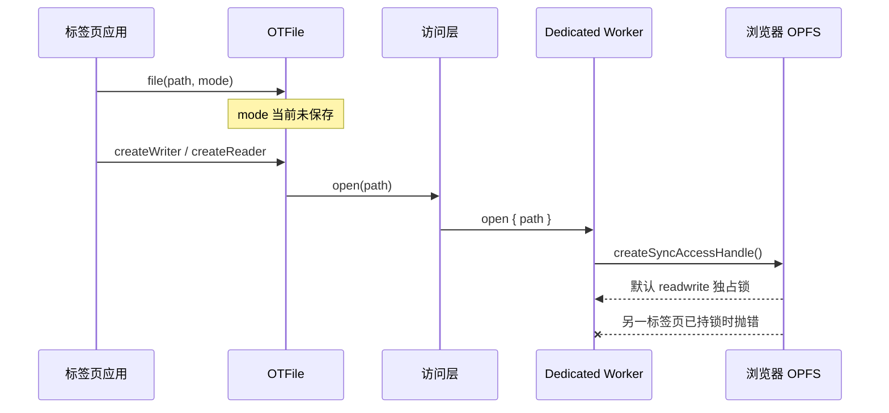
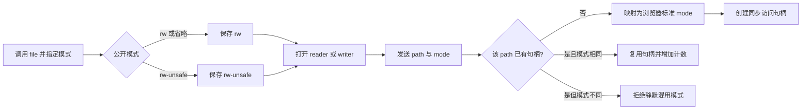
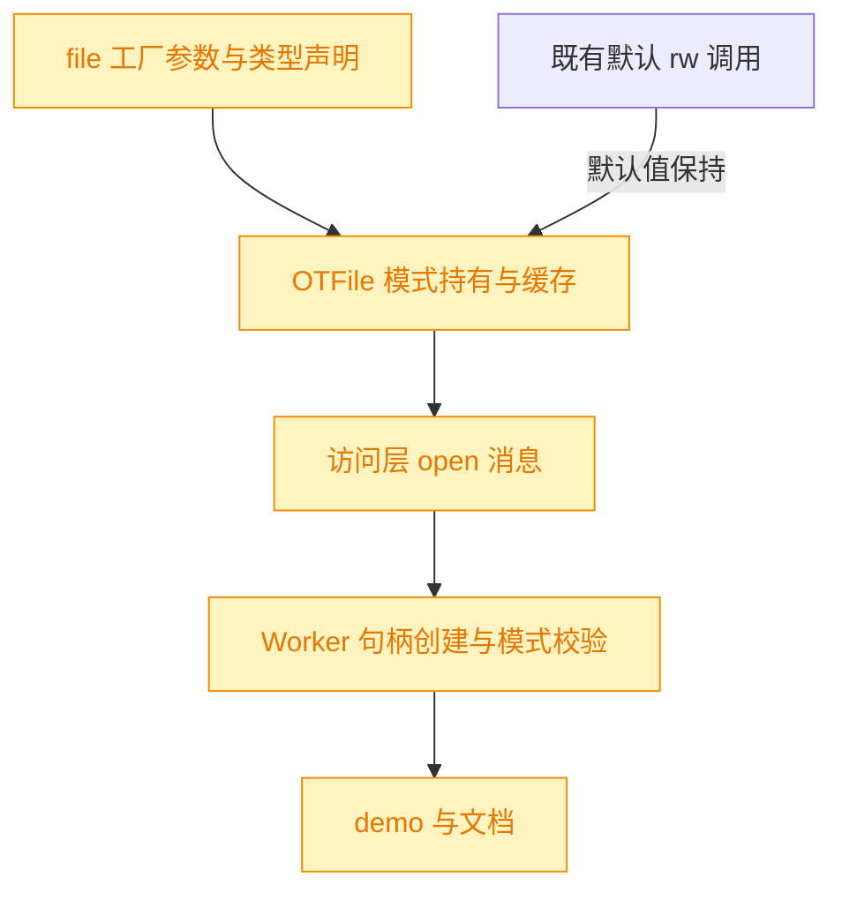

# 多标签页 rw-unsafe 文件打开模式

## 1. 背景

当前 `file(path).createWriter()` 最终调用不带参数的 `FileSystemFileHandle.createSyncAccessHandle()`，浏览器因此采用默认 `readwrite` 模式并对文件施加独占锁。同一文件已在一个标签页持有访问句柄时，另一个标签页再次创建 writer 会抛出 `NoModificationAllowedError`。

用户要求在 `file()` 增加公开模式 `rw-unsafe`，使明确选择该模式的调用方可以在多个标签页中打开同一文件而不因访问句柄互斥报错。底层依据 [MDN `readwrite-unsafe` 模式说明](https://developer.mozilla.org/zh-CN/docs/Web/API/FileSystemFileHandle/createSyncAccessHandle#readwrite-unsafe) 使用 `createSyncAccessHandle({ mode: 'readwrite-unsafe' })`。

工作区已有本需求的部分未提交改动：声明了 `TFileMode`，并给 `file()` / `OTFile` 增加了尚未向 Worker 传递的 mode 参数，同时在 demo 中加入了复现调用。本 spec 在这些改动上继续完成实现，不覆盖其他既有修改。

## 2. 需求

- `file(filePath, { mode: 'rw-unsafe' })` 创建的 `OTFile` 在 reader / writer 打开底层同步访问句柄时使用 `readwrite-unsafe`。
- `file(filePath)` 与显式 `mode: 'rw'` 保持现有默认 `readwrite` 独占锁语义，避免静默改变既有用户的数据一致性保障。
- 多个标签页都使用 `rw-unsafe` 打开同一文件时，不再因另一个访问句柄已存在而抛出 `NoModificationAllowedError`。
- 同一标签页内仍保留现有单个 `OTFile` 实例的 writer 互斥；本次只放宽浏览器对跨标签页同步访问句柄的锁约束，不提供跨标签页写入排序或冲突合并。
- 更新 demo、类型声明与必要文档，并以类型检查、构建和浏览器测试验证默认模式与新模式。

## 3. 现状分析

当前调用链在页面侧创建 `OTFile`，经访问层向 Dedicated Worker 发送 `open`，最终在 Worker 内调用无参数 `createSyncAccessHandle()`。虽然工作区已把 `mode` 放进 `file()` 与构造函数签名，但构造函数未保存它，reader / writer 未传递它，消息协议也没有 mode 字段，因此运行时行为仍全部是默认 `readwrite`。

缓存是另一个必须同步处理的正确性点。现有 `fileCache` 仅以 path 为键；如果先按默认模式获取某 path，再请求 `rw-unsafe`，会直接返回首个实例并吞掉新 mode。简单改成 path+mode 后，GC 兜底也必须识别复合缓存键，并且只有该 path 已无任何存活 wrapper 时才可 `forceClose`，否则旧实例的终结回调可能误关另一模式实例正在使用的共享 Worker 句柄。

现状精确信息（文件、行号与缺口）

- `src/common.ts:1,14-17`：已有公开 `TFileMode = 'rw' | 'rw-unsafe'`，但全局 `createSyncAccessHandle` 声明不接受 options。
- `src/file.ts:40-49`：已有 `file(filePath, opts)` 雏形，但缓存仍仅按 path 命中；注册给 `FinalizationRegistry` 的 held value 也仅为 path。
- `src/file.ts:120-126`：构造函数接收 mode 但未保存；`:141,186` 两个打开点只传 path。
- `src/access-worker.ts:207-223`：`createOPFSAccess` 与 `open` 消息仅携带 path。
- `src/opfs-worker.ts:34-48`：句柄表仅记录 Promise 与引用计数，创建时无 options，也无法检测同一标签页内混用模式。
- `demo/test.ts:26`：已有多标签页复现调用，但尚未指定 `rw-unsafe`，且 writer 未关闭。

## 4. 技术实现方案

对外保留简短的库级模式名，对内在 Worker 边界映射到浏览器标准模式名。mode 从 `OTFile` 实例沿 `createOPFSAccess` 和 `open` 消息一路传递，只有真正创建新同步访问句柄时才转换并传给 Web API；同 path 的后续 open 继续复用 Worker 内既有句柄与引用计数。

### 4.1 模式类型与映射

- `TFileMode` 继续只暴露 `'rw' | 'rw-unsafe'`；默认值为 `'rw'`。
- 增补 Worker-only DOM 类型声明，使 `createSyncAccessHandle(options?)` 接受 `mode: 'readwrite' | 'readwrite-unsafe'`。
- 在 Worker 内集中映射：`rw → readwrite`，`rw-unsafe → readwrite-unsafe`。即使安全模式可省略参数，也显式传入映射结果，使消息语义和测试断言一致。
- 不支持 `read-only`：本次需求只新增可写的不安全模式，现有 reader 与 writer 共享同一个可读写句柄模型；引入只读模式会改变句柄复用与 writer 能力边界，超出范围。

### 4.2 OTFile 模式持有与缓存

- `OTFile` 新增只读私有 mode 字段，构造时规范化缺省值；`createReader()` / `createWriter()` 都把该 mode 交给访问层。
- `fileCache` 改为以 path+mode 的无歧义复合键缓存，保证相同 path+mode 仍返回同一实例并维持当前实例级 writer 互斥，不同 mode 不再互相吞参。
- `FinalizationRegistry` held value 同时携带 path 与复合缓存键。回调只删除对应键，并扫描确认该 path 没有其他存活的 mode 实例后才触发 `forceClose`，保持现有“晚到终结回调不得误关新实例”的安全约束。
- mode 不新增公开 getter：当前需求只要求控制打开行为，公开 getter 会无必要地扩大 API 面；生成的函数声明已经能表达可选参数。

### 4.3 Worker 消息与句柄复用

- `createOPFSAccess(filePath, mode)` 的 `open` 消息增加 mode，读写代理的其他消息保持不变。
- Worker 的句柄 entry 记录创建它的 `TFileMode`。没有 entry 时用映射后的标准 mode 创建句柄；已有 entry 且 mode 相同则继续复用现有 Promise 并递增 count。
- 同一 Worker 内同 path 同时请求不同 mode 时立即返回描述性错误，不静默复用错误模式。跨标签页的安全/不安全混用仍由浏览器锁规则拒绝；只有所有并发句柄均为 `readwrite-unsafe` 时才承诺多标签页可打开。
- 保留现有“创建 Promise 在 await 前写入 Map”的竞态防护、open 失败清理、close 引用计数、空闲通知与 path 粘性路由。

### 4.4 验证与文档

- 为默认 `rw` 与 `rw-unsafe` 增加浏览器测试，验证两者可读写、同 path+mode 缓存稳定、不同 mode 不再返回同一 wrapper，并覆盖模式冲突不被静默吞掉。
- 将 demo 复现调用改为 `rw-unsafe`，使用 `await using` 或显式 close，便于在两个标签页打开 demo 观察不再报错且不遗留句柄。
- 在 README 的 file 使用区补充 `rw-unsafe` 多标签页示例与“并发写入不保证排序/一致性”的风险提示；构建时让现有生成器同步刷新 `docs/api.md` 声明。
- 执行 TypeScript 检查、生产构建与浏览器测试。跨标签页属于浏览器原生锁行为，若自动化测试框架无法在现有套件内可靠创建第二个标签页，则保留 demo 作为人工复验入口，但底层 options 传递必须由自动测试覆盖。

### 4.5 兼容性与影响范围

本次无对外 breaking change：第二参数为可选，默认仍是安全的 `rw`。受影响范围包括工厂类型、wrapper 缓存与 GC 兜底、访问层消息、Worker 句柄 entry、demo 和文档。`rw-unsafe` 本身允许跨标签页并发写，调用方必须接受写入交错、覆盖或最后写入者获胜等数据竞争风险；库不在本次加入跨标签页锁、协调协议或冲突合并。

实施精确层（签名与文件落点）

- `src/common.ts`：补齐 native mode 类型与 `createSyncAccessHandle(options?)` 声明。
- `src/file.ts`：规范化 mode、持有 `#mode`、按复合键缓存、调整 finalizer held value 与存活检查，并在两个 `createOPFSAccess` 调用点传 mode。
- `src/access-worker.ts`：把 `createOPFSAccess(filePath, mode)` 的 mode 放入 `open` 消息。
- `src/opfs-worker.ts`：entry 增加 mode，首次 open 映射并传给 Web API，复用前校验模式一致。
- `src/__tests__/file.test.ts`（必要时加 Worker 测试入口）：覆盖公开 API 与模式冲突；`demo/test.ts`、`README.md` 更新示例。
- 现有 `write(stringPath, ...)` 没有新增 mode 参数；需要不安全写入时先构造 `file(path, { mode: 'rw-unsafe' })` 并把 `OTFile` 传给 `write`，避免扩大本次 API 范围。

## 5. 待确认项

_暂无_

## 6. 任务清单

- [x] 补齐 `src/common.ts` 的公开文件模式、底层访问模式与 `createSyncAccessHandle(options?)` 类型声明（验收：`rw` / `rw-unsafe` 到 native mode 的类型边界清晰，TypeScript 检查通过）
- [x] 完成 `src/file.ts` 的 mode 规范化、实例持有、reader/writer 透传、path+mode 缓存及多模式安全 finalizer（验收：相同 path+mode 复用实例，不同 mode 不互相吞参，GC 回调不会误关其他存活实例）
- [x] 修改 `src/access-worker.ts` 的打开协议以透传 mode（验收：`createOPFSAccess` 的 open 消息同时包含 filePath 与 mode，其他消息行为不变）
- [x] 修改 `src/opfs-worker.ts` 的句柄 entry、native mode 映射与同 path 模式冲突校验（验收：首次打开按目标 mode 调用 Web API，同模式复用，异模式不会静默复用）
- [x] 在浏览器测试中覆盖默认模式、新模式、缓存隔离与同 path 模式冲突（验收：新增断言通过且既有 reader/writer 与 Worker 池测试无回归）
- [x] 更新 `demo/test.ts` 与 `README.md` 的多标签页 `rw-unsafe` 用法及并发写风险说明（验收：demo 关闭 writer，README 示例与实际 API 一致）
- [x] 运行格式化、TypeScript 检查、生产构建和完整浏览器测试并记录结果（验收：可用验证命令全部通过，生成 API 声明包含 mode 参数）

## 7. 执行记录

- 2026-10-20：完成类型与打开链路。`TFileMode` 增加 `rw-unsafe`，Worker-only DOM 声明接受 native mode；`OTFile` 保存 mode，reader/writer 经访问层 open 消息传到 Dedicated Worker，再映射为 `readwrite` / `readwrite-unsafe` 调用浏览器 API。
- 2026-10-20：完成缓存与生命周期保护。`fileCache` 改为 path+mode 复合键；finalizer 精确淘汰对应键，并只在同 path 已无其他存活 wrapper 时 force-close，避免多模式实例之间互相吞参或误关句柄。
- 2026-10-20：Worker 句柄 entry 记录 mode；同 path 同模式继续共享创建 Promise 和引用计数，不同模式在同一 Worker 内返回描述性错误，保留原有并发 open 抗竞态与空闲回收逻辑。
- 2026-10-20：新增浏览器测试覆盖缓存隔离、unsafe 跨独立 Worker 并发打开成功、默认 rw 跨 Worker 仍保持独占，以及同 path 异模式不静默复用。独立 Worker 用例等价覆盖不同标签页各自 Dedicated Worker 的浏览器锁行为；`file.test.ts` 30 个用例通过。
- 2026-10-20：demo 改为 `file(path, { mode: 'rw-unsafe' })` 并通过 `await using` 自动关闭；README 增加多标签页示例与并发写不排序、不解决冲突的风险提示。
- 格式化：核心源码、README 与 spec 已由 Prettier 格式化；仓库当前 Prettier 版本无法解析项目既有的 `await using`，因此测试与 demo 文件由 TypeScript 编译和测试验证，未强制交给 Prettier 重写。
- 验证：`npx tsc -p tsconfig.json --noEmit` 通过；`npm run build` 通过并生成包含 `opts.mode?: TFileMode` 的 API 声明；`npx vitest run` 通过，6 个测试文件、56 个用例全绿。directory 测试输出的未关闭句柄与 `NoModificationAllowedError` stderr 为既有用例主动覆盖的预期异常，不是失败。
- 2026-10-20：全部非 manual 任务完成，待确认项为 `_暂无_`，无批注与追加任务，spec 标记为 `done`。
